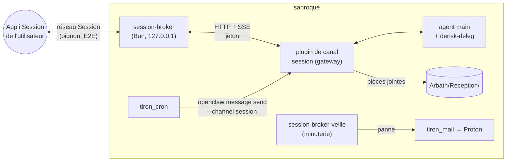

# Canal Session Messenger pour Secretarius — conception

Date : 2026-11-18. Branche : `feat/canal-session`. Contexte : note
`Secretarius_dev/Architecture/2026-11-17-citadelle-et-ouverture.md` (Session = allié aveugle,
Telegram = service voyant).

## 1. Intention

Remplacer Telegram par Session Messenger pour tout échange entre l'utilisateur et
Secretarius. Raisons de l'utilisateur : Session n'exige pas de numéro de téléphone et ses
métadonnées ne sont pas lisibles de l'extérieur. Session compte surtout **hors du tailnet**
(téléphone sans Tailscale) et pour **capturer vite** une idée ou une référence (`/c`). Un
premier résultat « brut de fonderie » est acceptable.

Réussite : pouvoir retirer Telegram sans rien perdre.

## 2. Répartition des canaux (décisions de l'utilisateur)

| Usage | Canal cible |
|---|---|
| Conversation avec Tiron (agent `main`), commandes tapées (`/c`, `/q`, `/source`, `/confirm`, `/jeton`…) | **Session** |
| Rappels à heure fixe de `/cron` | **Session** |
| Tout autre envoi spontané : avis « livraison dans Réception/ », réponses aux commandes reçues par courriel, comptes rendus de consignes, alerte de panne | **Proton** (courriel de `tiron@secretarius.co` aux adresses du propriétaire) |
| Telegram | reste actif **en parallèle** pendant la transition, puis retiré en une fois |

## 3. Objectifs, non-objectifs, anti-objectifs

**Objectifs**
- Converser avec Tiron et taper toutes les commandes depuis Session, avec le même
  comportement que sur Telegram (même agent `main`, mêmes crochets `derisk-deleg`).
- Recevoir des **pièces jointes** : chacune est déposée dans `~/Documents/Arbath/Réception/`
  avec une note ; Tiron confirme le dépôt.
- Rappels `/cron` livrés sur Session ; autres envois spontanés par Proton.

**Non-objectifs (pour l'instant)**
- Traiter le contenu d'une pièce jointe (transcription, lecture, vision). Plus tard, le texte
  du message pourra dire quoi en faire : la conception garde texte et pièces jointes ensemble
  pour le permettre, sans l'implémenter.
- Envoyer des fichiers à l'utilisateur (Tiron n'envoie que du texte).
- Groupes Session, communautés (SOGS), plusieurs comptes de bot.
- Affichage progressif (streaming) des réponses : message final seulement.
- Précision des rappels à la minute : la plupart des rappels courants seront faits par Grok
  Bot ou un autre agent externe.

**Exigences de sécurité — font partie de « ça marche »** (précision de l'utilisateur : un
accès non autorisé ou une phrase secrète divulguée, c'est un canal qui ne marche pas)
- **Seuls les identifiants Session autorisés commandent Tiron.** Liste blanche (au départ :
  celui de l'utilisateur) ; les autres sont ignorés sans réponse ni accusé, et journalisés.
  Tests obligatoires : un expéditeur hors liste n'atteint jamais l'agent ; le broker refuse
  d'écrire à un identifiant hors liste.
- **La phrase secrète de Tiron ne sort jamais de `~/.config/secrets.env`** : ni dépôt, ni
  gateway, ni conteneur, ni journal, ni sortie de commande. Le broker et le plugin ne
  s'acceptent qu'avec le jeton partagé, sur 127.0.0.1 seulement.

**Anti-objectifs (ce qui serait un échec même si « ça marche »)**
1. **Message perdu sans que personne ne le sache.** Mesures : accusé de réception (§ 5.4),
   envoi sortant réessayé puis échec journalisé.
2. **Panne silencieuse** (réseau Session modifié, Session.js cassé). Mesure : alerte par
   courriel Proton (§ 5.6).

## 4. Contraintes établies

- La couche réseau de Session.js (`@session.js/bun-network`) ne tourne que sous **Bun** ; le
  gateway OpenClaw 2026.8.2 tourne sous **Node 24**. D'où deux processus.
- Vérifié le 2026-11-18 (test écho jetable) : `@session.js/client` **0.0.57** et
  `@session.js/bun-network` **1.0.15**, Bun **1.2.4** (`~/.bun/bin/bun`), réception puis
  réponse en ~6 s. API : `await ready; const s = new Session(); s.setMnemonic(m, nom);
  s.addPoller(new Poller()); s.on("message", …); s.sendMessage({ to, text })`. Disponibles
  aussi : `markMessageAsRead`, indicateur de saisie, `getFile`, `acceptConversationRequest`.
  Le postinstall de `protobufjs` bloqué par Bun est sans effet. Épingler ces versions
  (fichier de verrouillage commité).
- Précédent : `github.com/mauceri/session_bot` (`sessionBroker.ts`) — identité, dédoublonnage
  SQLite des identifiants de message, pièces jointes. On reprend ces idées, **sans** le
  WebSocket découpé en paquets ni la partie Python.
- Modèle de canal externe : le plugin **`@openclaw/signal@2026.8.2`** (même version que le
  gateway) parle à un démon local (`signal-cli`) en HTTP + SSE. C'est la référence à lire
  pour le cycle de vie d'un compte, la réception et l'envoi. Docs du paquet `openclaw` :
  `docs/plugins/sdk-channel-plugins.md`, `sdk-channel-inbound.md`, `sdk-channel-outbound.md`.
- Le crochet `before_agent_reply` de `derisk-deleg` ne dépend pas du canal : tout message
  de l'agent `main` y passe. Le canal d'origine est `ctx.messageProvider` (vaudra `session`).
- Le gateway ne reçoit de `secrets.env` que les clés de sa liste blanche
  (`ajoutGateway`, `derisk-deleg/src/secrets-sync.ts` : `GMAIL_APP_PASSWORD`, `PROTON_*`,
  `TIRON_*`). Conséquence voulue : `SESSION_BOT_MNEMONIC` n'y entre pas ;
  `TIRON_SESSION_BROKER_TOKEN` et `TIRON_SESSION_ID` y entrent.
- Envois Proton existants : `tiron_mail` (`ecrire --automatique` = adresses du propriétaire
  seulement, depuis `tiron@secretarius.co`).
- Pièges connus : redémarrer `openclaw-gateway` après tout changement de plugin ;
  `derisk-deleg` et tout plugin installé sont des **copies** (`openclaw plugins install
  … --force`) ; services systemd = PATH minimal.

## 5. Conception

### 5.1 Vue d'ensemble

Deux composants neufs dans le dépôt :
- `session-broker/` — démon Bun, **transport seulement** (aucune écriture dans les coffres,
  aucune décision métier).
- `openclaw-session/` — plugin de canal OpenClaw `session` (TypeScript, Node), installé par
  `openclaw plugins install`.

### 5.2 session-broker (Bun)

Service utilisateur systemd `session-broker.service`, `Restart=on-failure`. Une enveloppe de
lancement extrait de `~/.config/secrets.env` les **seules** clés `SESSION_BOT_MNEMONIC` et
`TIRON_SESSION_BROKER_TOKEN` (même méthode que l'enveloppe `~/.local/bin/openclaw` pour le
jeton du gateway), jamais tout le fichier.

Comportement :
- Identité : `setMnemonic(SESSION_BOT_MNEMONIC, "Tiron")`. Absente → refus de démarrer.
- Écoute **seulement** sur `127.0.0.1:<port>` (port fixé dans la config, à choisir libre).
  Toute requête exige `Authorization: Bearer <TIRON_SESSION_BROKER_TOKEN>`.
- Réception (poller Session.js) :
  1. dédoublonnage par identifiant de message (SQLite dans
     `~/.local/state/session-broker/`) ;
  2. **liste blanche** : expéditeur hors de `allowFrom` → journal (8 premiers caractères de
     l'identifiant), aucune réponse, aucun accusé, rien transmis ;
  3. pièces jointes : déchiffrées (`getFile`) et écrites dans
     `~/.local/state/session-broker/media/` (répertoire 0700, fichiers 0600, nom unique) ;
  4. **accusé de réception** : `markMessageAsRead` dès que le message est mis en file ;
  5. événement publié sur le flux SSE : `{ id, from, timestamp, text, attachments: [{ path,
     name, contentType, size }] }`. Les événements non acquittés par le plugin sont rejoués à
     la reconnexion (au moins une fois ; le plugin dédoublonne par `id`).
- Routes HTTP (forme indicative, à ajuster au plugin) :
  - `GET /events` (SSE) ; `POST /ack {id}` ;
  - `POST /send {to, text}` → `{messageId, timestamp}` ; `to` doit être dans `allowFrom`
    (le broker refuse d'écrire à un inconnu) ;
  - `POST /typing {to, on}` ;
  - `GET /health` → `{ ok, lastPollOkAt, lastSendOkAt, sessionId }`.
- Envoi : 3 essais espacés en cas d'échec, puis erreur rendue au plugin et journalisée.
- Journaux : jamais la phrase secrète, jamais le texte complet des messages (longueur
  seulement), identifiants tronqués.
- Configuration non secrète : `~/.config/session-broker/config.json`
  (`port`, `allowFrom: ["05…"]`, chemins). `allowFrom` au départ = l'identifiant Session de
  l'utilisateur, **en entier** (66 caractères) : l'utilisateur le copie depuis son application
  (Paramètres → identifiant de compte) ; les journaux n'en gardent que 8 caractères.

Création de l'identité : commande `session-broker init` qui génère une phrase secrète,
l'**ajoute** à `~/.config/secrets.env` (mode 0600 conservé) avec un
`TIRON_SESSION_BROKER_TOKEN` aléatoire, et n'affiche **que** l'identifiant Session du bot.
Refuse si `SESSION_BOT_MNEMONIC` existe déjà.

### 5.3 Plugin de canal `session` (gateway)

Calqué sur `@openclaw/signal@2026.8.2` (démon externe en HTTP + SSE).
- Canal `session`, un compte `default`. Config `channels.session` :
  `{ enabled, brokerUrl, dmPolicy: "allowlist", allowFrom: ["05…"] }` ; le jeton vient de
  `TIRON_SESSION_BROKER_TOKEN` (environnement du gateway, via `/maj`).
- `openclaw.json` (modèle `openclaw-config/openclaw.json.template` et config vivante) :
  - `bindings` : `{ agentId: "main", match: { channel: "session", accountId: "default" } }` ;
  - `commands.ownerAllowFrom` : ajouter `session:<identifiant de l'utilisateur>` ;
  - Telegram inchangé pendant la transition.
- Réception : abonnement SSE au broker pendant la vie du compte ; chaque événement passe par
  le pipeline d'entrée du SDK (`channel-inbound`), avec `messageProvider = "session"`, puis
  `POST /ack`.
  - **Message avec pièce(s) jointe(s)** : le plugin déplace chaque fichier dans
    `~/Documents/Arbath/Réception/` et y écrit une note (voir § 5.5), répond « Reçu : <n>
    pièce(s) jointe(s) déposée(s) dans Réception/ » et **ne transmet pas** le message à
    l'agent. (Le jour où le texte portera une instruction, c'est ici qu'on le transmettra.)
  - Message texte seul : transmis à `main` comme un message Telegram.
- Indicateur de saisie : `POST /typing` pendant que l'agent travaille (si le SDK expose le
  signal ; sinon, on s'en passe).
- Sortie : `sendText` → `POST /send`. Pas de capacités « live » (pas d'édition, pas de
  prévisualisation). Découpage des longs messages par le découpeur du cœur, limite à
  vérifier contre Session.
- Texte brut : Session n'interprète pas le HTML de Telegram (§ 5.7).

### 5.4 Accusé de réception

Côté utilisateur : son message passe à « lu » dès que le broker l'a pris en charge, puis
« en train d'écrire » pendant le travail de Tiron. Un message qui reste non lu signale un
problème. Pas de message texte « reçu » supplémentaire (choix de conception, réversible).

### 5.5 Dépôt des pièces jointes

Dans `~/Documents/Arbath/Réception/` (choix de l'utilisateur : Arbath = vie courante,
Secretarius = projet et wiki principal) :
- le fichier, sous son nom d'origine assaini, préfixé de la date (`2026-11-18 1502 <nom>`),
  sans écraser un fichier existant ;
- une note `2026-11-18 1502 Session.md` : en-tête (`origine: session`, date, expéditeur
  tronqué), le **texte du message** tel quel, et un lien Obsidian vers chaque fichier.
- Taille : la limite de Session (~10 Mo, à confirmer) suffit ; au-delà, le broker journalise
  et le plugin répond que la pièce n'a pas pu être reçue.

### 5.6 Alerte de panne

Minuterie utilisateur `session-broker-veille.timer` (toutes les 5 min) : interroge
`GET /health` ; si le service est arrêté, injoignable, ou si `lastPollOkAt` a plus de
15 min, envoie **un** courriel Proton (`tiron_mail ecrire --automatique`) « Session : Tiron ne
reçoit plus depuis <heure> ». Une seule alerte par incident (marqueur dans
`~/.local/state/session-broker/`), et un courriel de rétablissement.

### 5.7 Adaptations ailleurs dans Secretarius

| Endroit | Changement |
|---|---|
| `derisk-deleg/src/wiki-ops.ts` et autres formatages « brief » | `ctx.messageProvider === "session"` → texte brut, sans échappement HTML ni balises (Telegram garde son HTML) |
| `derisk-deleg/src/aide.ts` | `/aide` mentionne Session ; test de complétude conservé |
| `derisk-deleg/src/jeton-ops.ts` | commentaire « Telegram seulement » → « canal direct (Telegram, Session) » ; le comportement ne change pas (le crochet ne filtre pas par canal) |
| `tiron_cron` (`syntax.py`, `nl.py`, `openclaw_cli.py`) | canal `session` reconnu ; destinataire `TIRON_SESSION_ID` ; un rappel créé depuis Session revient sur Session |
| `tiron_cron/livraison.py`, `__main__.py` | l'avis « Nouvelle livraison dans Obsidian… » part par **courriel Proton** (`tiron_mail`), plus par Telegram |
| `tiron_mail/releve.py` | la réponse à une commande reçue par courriel part par **courriel Proton** à l'expéditeur propriétaire, au lieu de `--reply-channel telegram` ; message « à taper sur Telegram » → « à taper sur Session ou Telegram » |
| `secrets-sync.ts` (`/maj`) | rien : `TIRON_*` déjà en liste blanche |
| `openclaw-config/openclaw.json.template`, tests de profil | canal `session`, binding, `ownerAllowFrom` |

## 6. Phases

1. **Conversation et commandes sur Session** (Telegram intact) : broker, `init`, service,
   plugin, binding, liste blanche, accusé de réception, pièces jointes → Réception, texte brut
   dans `derisk-deleg`. *Critère :* depuis le téléphone **hors Tailscale** (données mobiles,
   Tailscale coupé), `/c <idée>`, `/c <url>`, `/q`, `/source`, `/confirm` fonctionnent ; une
   photo arrive dans `Arbath/Réception/` avec sa note ; un second compte Session non autorisé
   n'obtient rien.
2. **Envois spontanés** : rappels `/cron` sur Session, avis et réponses de relève par Proton,
   alerte de panne. *Critère :* un rappel posé depuis Session arrive sur Session ; une
   livraison `/cron` produit un courriel ; arrêter le broker produit une alerte en ≤ 20 min,
   puis un courriel de rétablissement.
3. **Retrait de Telegram** (sur décision de l'utilisateur) : canal Telegram désactivé, clés et
   garde-fou Telegram de `/maj` retirés, installateur mis à jour (broker, plugin, `init`),
   `/aide` final. À vérifier avant : à quoi servent aujourd'hui les approbations d'exécution
   Telegram (`execApprovals`) et s'il faut un équivalent sur Session.

## 7. Laissé au constructeur

Port du broker ; noms exacts des routes ; format SSE ; mécanisme de rejeu ; découpage des
messages longs et limite réelle de Session ; usage précis des helpers du SDK (en suivant le
plugin Signal) ; acceptation automatique des demandes de conversation des identifiants
autorisés ; nom de fichier assaini des pièces jointes ; tests (Bun test pour le broker avec
un faux client Session ; vitest pour le plugin ; pytest pour `tiron_cron`/`tiron_mail`).
